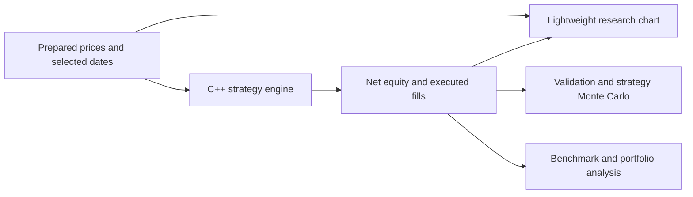

# Integrated chart and quantitative research

The chart displays supplied prices; the engine calculates strategies. Neither
the chart library nor the hosted market widget provides prices to the engine.

## Workspace

Stock desk tabs keep every selected-stock tool in context. Charts offers both
Research chart (local Lightweight Charts) and TradingView widget (hosted data).
Indicators and source data are separate chart choices. Saved research contains
experiments, comparison studies, validation studies, evidence and reports.
Assistant provider selection lives in Settings and survives navigation.

## Chart and stock search

The bundled library is TradingView Lightweight Charts 5.2.1, Apache 2.0. The
upstream package integrity and bundle checksum are recorded in
`app/vendor/lightweight-charts.json`; LICENSE and NOTICE are retained. The local
template contains presentation logic only. Imported labels enter an escaped JSON
block and text nodes. No remote data script is needed to draw research prices.

Candles, volume, overlays, indicator panes and trade markers share one timeline.
Pre-window indicator warm-up stays outside the visible window. Strategy markers
come from actual submitted C++ fills, not indicator crossings reconstructed by
the browser. A linked development backtest displays its effective source window.
Clicking a candle shows its fills, quantities, prices and fees within the chart.

Search uses the current cached public instrument catalogue plus prepared local
histories. Identifier discovery does not establish price coverage, historical
listing identity, delisted membership or exchange data rights. A history download
is explicit and retains the pinned-source checks and 2020 cutoff. BSE identifiers
are not silently substituted into an NSE research history.

## Cross-stock comparison

Choose 1–8 prepared adjusted stocks and at least 100 observed source sessions.
Every included stock must cover the same reference dates without filling gaps.
The final 30% of this source window is evaluated; earlier observations warm up
causal features. Fixed default rule parameters and identical explicit bps costs
are used for each stock and its buy-and-hold benchmark. Exclusions and their
reasons remain part of the exported study. Frozen final-period overlap is rejected
for the same source/window protocol identity.

These are exploratory fixed-rule comparisons. A chronological split does not
establish that a user has never inspected or tuned against those outcomes.
The cached cohort is not survivorship-controlled. Selecting a subset after
viewing performance changes the experiment and must not be presented as untouched
out-of-sample evidence. Full C++ results, request hashes and data hashes are kept.

## Robustness and benchmark diagnostics

Robustness uses the submitted stock backtest's exact dates, capital and costs.
Price/volume rules use a small fixed lookback/volume grid; other rules vary only
relevant controls. Cost cases multiply the original cost and slippage assumptions,
never a preceding stressed case. Final-period results are not a tuning workspace.
Inspecting a grid creates development evidence, not an independently validated
winner or a probability of future success.

C++ benchmark diagnostics use aligned net daily returns: sample covariance for
beta and correlation, annualized active-return volatility for tracking error,
and the information ratio. Annualization assumes 252 observations/year.
Flat-return statistics are unavailable where undefined. The supplied same-stock
buy-and-hold reference is not a broad market index or a claim of market alpha.

## Portfolio model

Initial weights allocate capital to the comparison's net strategy sleeves; the
same weights also construct a costed buy-and-hold portfolio. Weights must be
nonnegative, obey the initial cap and sum to at most 100%. The remainder is cash
earning zero. There is no leverage, optimisation or rebalancing. Entry caps do
not prevent weight drift later. Existing proportional research costs are retained
in sleeve NAVs; broker fixed charges, impact and order queues are not repriced.

The engine requires exactly matching dates; missing dates are not intersected
away or forward-filled. It calculates portfolio equity, drawdown, annualized
sample volatility, zero-risk-free Sharpe and sleeve correlations. Zero-variance
correlations stay missing. The model evaluates the selected allocation; it does
not establish a universally optimal portfolio.

## Forward paper journal

The local paper account holds cash and whole-share positions. Every hypothetical
fill requires a provider-verified instrument and a quote timestamp no more than
120 seconds old and not in the future. C++ applies submitted slippage and bps
charges; insufficient cash and overselling are rejected. SQLite updates cash,
positions and the fill record atomically. Repeated order IDs do not create a
second fill. Recorded fields include source and receipt timestamps and native
calculation provenance. No live order is transmitted.

Configure the account offline. To record forward fills, provide your own permitted
broker token and verified instrument mappings through Monitoring. A current quote
is not sufficient to generate the daily strategy: a completed-current-candle
ingestion connector is still needed. Historical 2020 recommendations are never
promoted to current signals. Continuous monitoring needs a running worker and an
awake connected host. Paper fills do not model queue priority or market impact.

## Code map

- `app/light_chart.py` and `app/chart_view.html`: payload alignment and rendering.
- `app/stock_search.py`: identifier search and explicit history preparation.
- `app/quant_research.py`: experiment orchestration and data contracts.
- `app/quant_workspace.py`: comparison, sensitivity and portfolio views.
- `engine/include/research.hpp`: portfolio, benchmark and paper arithmetic.
- `app/paper_journal.py`: quote checks, account persistence and paper ledger UI.
